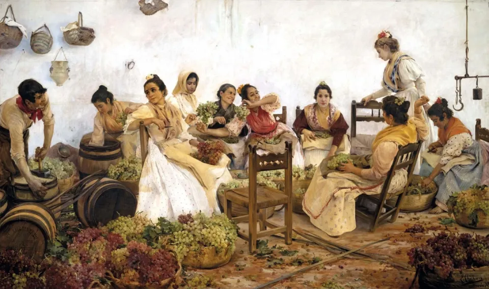
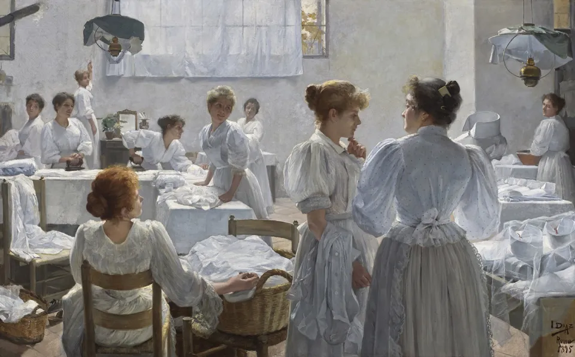
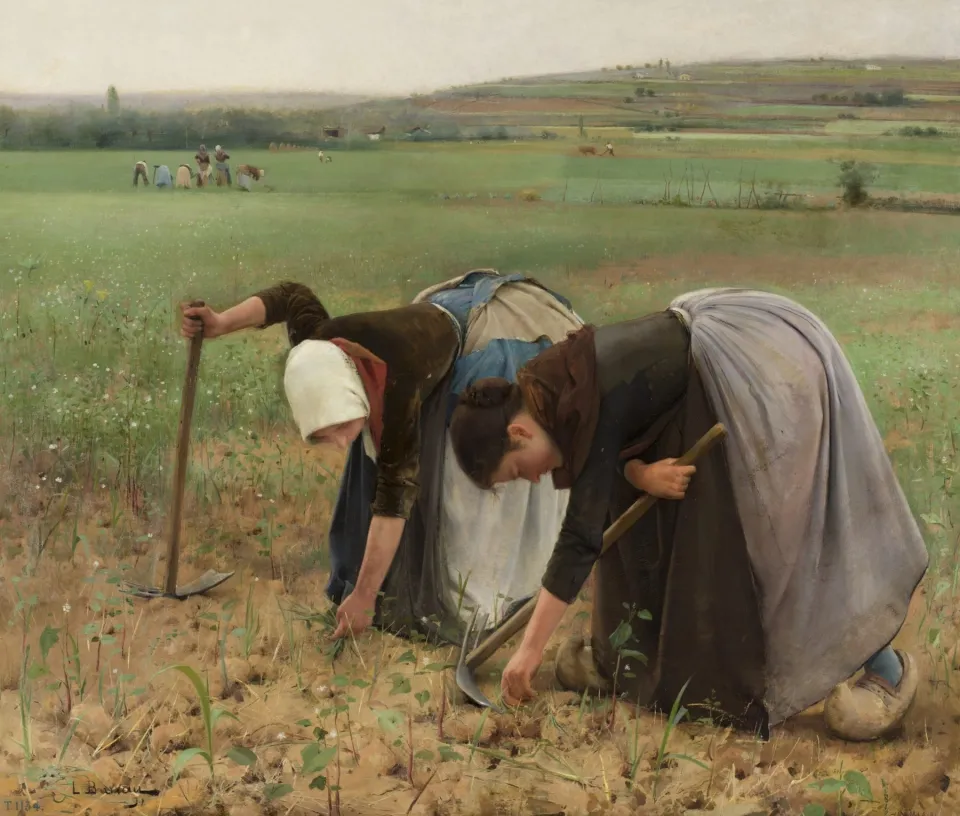
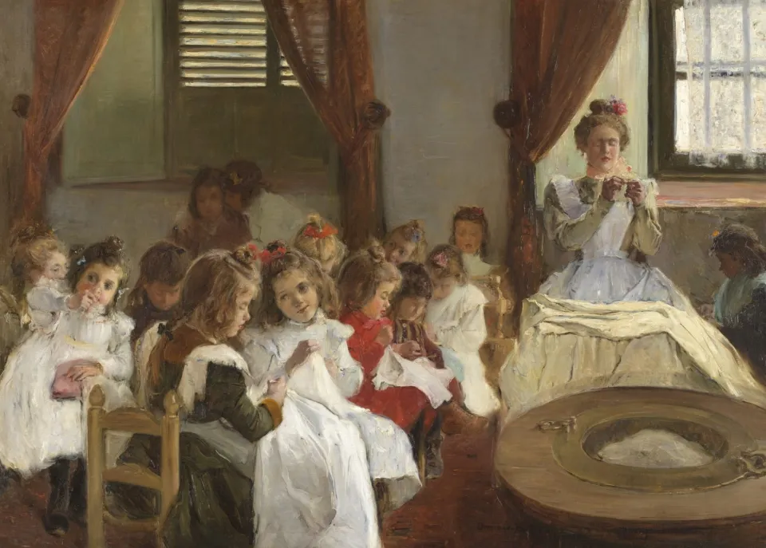

```{=html}
<section class="cover" aria-labelledby="cover-title">
  <h1 id="cover-title" class="cover-title">
    <span>Coding Provenance</span>
    <span>Workshop</span>
  </h1>
  <p class="cover-edition">Second Edition</p>
  <p class="cover-summary">This is the materials site for the second edition of the Coding Provenance Workshop: four days on computational provenance, meaning provenance research with statistics, network analysis, optical character recognition, large language models and natural language processing. Here you find the sessions, the readings and the materials for each step of the workflow.</p>
  <dl class="cover-meta">
    <div><dt>Dates</dt><dd><time datetime="2026-12-01">1</time>–<time datetime="2026-12-04">4 December 2026</time></dd></div>
    <div><dt>Venue</dt><dd>Getty Research Institute, Los Angeles</dd></div>
    <div><dt>Partners</dt><dd>Provenance Lab, Leuphana University of Lüneburg, and the Getty Provenance Index</dd></div>
  </dl>
</section>

<section class="ledger" aria-labelledby="materials">
  <h2 id="materials">Materials</h2>
  <table class="ledger-table">
    <thead>
      <tr><th scope="col" class="no">No.</th><th scope="col">Entry</th><th scope="col">Part</th><th scope="col">Status</th></tr>
    </thead>
    <tbody>
      <tr>
        <td class="no">001</td>
        <td class="entry"><a href="second-session.html">Second Online Session</a><span class="desc">Agenda, recordings and slides.</span></td>
        <td class="part">Online session</td>
        <td class="status-cell"><span class="status" data-status="to come">To come</span></td>
      </tr>
      <tr>
        <td class="no">002</td>
        <td class="entry"><a href="structuring-data.html">Structuring Data</a><span class="desc">Organising provenance data into consistent structures.</span></td>
        <td class="part">Workflow, step 1 of 4</td>
        <td class="status-cell"><span class="status" data-status="to come">To come</span></td>
      </tr>
      <tr>
        <td class="no">003</td>
        <td class="entry"><a href="preprocessing-data.html">Preprocessing Data</a><span class="desc">Cleaning, standardising and preparing data.</span></td>
        <td class="part">Workflow, step 2 of 4</td>
        <td class="status-cell"><span class="status" data-status="to come">To come</span></td>
      </tr>
      <tr>
        <td class="no">004</td>
        <td class="entry"><a href="analysing-data.html">Analysing Data</a><span class="desc">Methods and approaches for analysis.</span></td>
        <td class="part">Workflow, step 3 of 4</td>
        <td class="status-cell"><span class="status" data-status="to come">To come</span></td>
      </tr>
      <tr>
        <td class="no">005</td>
        <td class="entry"><a href="visualising-data.html">Visualising Data</a><span class="desc">Charts, maps and networks.</span></td>
        <td class="part">Workflow, step 4 of 4</td>
        <td class="status-cell"><span class="status" data-status="to come">To come</span></td>
      </tr>
      <tr>
        <td class="no">006</td>
        <td class="entry"><a href="resources.html">Bibliography &amp; Resources</a><span class="desc">Readings, tutorials, tools and datasets.</span></td>
        <td class="part">Reference</td>
        <td class="status-cell"><span class="status" data-status="entered">Entered</span></td>
      </tr>
    </tbody>
  </table>
</section>

<section class="about" aria-labelledby="about">
  <h2 id="about">About the workshop</h2>
  <div class="about-text">
    <p>After decades working as provenance and art history researchers, we have watched the field change in many ways. Computational techniques and a more data-driven approach can reveal patterns, structures and dynamics that are hard to uncover through close reading, and lead to research questions that were previously impossible to answer or even to ask. We call it computational provenance: provenance research using statistics, network analysis, optical character recognition, large language models and natural language processing.</p>
    <p>This workshop gives researchers and practitioners a first encounter with these theories, methods and tools, so they can bring new policies, methods and techniques into their institutions and their own research. Interdisciplinary work with computer scientists and digital humanities specialists is extremely valuable, and fair and equal collaboration starts with a good understanding of what can be done and how.</p>
  </div>
  <dl class="about-record">
    <div>
      <dt>Organisers and instructors</dt>
      <dd>Bárbara Romero Ferrón<span class="affil">Provenance Lab, Leuphana University of Lüneburg</span></dd>
      <dd>Lynn Rother<span class="affil">Provenance Lab, Leuphana University of Lüneburg</span></dd>
      <dd>Sandra van Ginhoven<span class="affil">Getty Provenance Index, Getty Research Institute</span></dd>
    </div>
    <div>
      <dt>Schedule</dt>
      <dd><span class="status" data-status="to come">To be announced</span></dd>
    </div>
    <div>
      <dt>All editions</dt>
      <dd><a href="https://barbararomero.github.io/codingprovenanceworkshop/">Coding Provenance Workshop</a></dd>
    </div>
  </dl>
</section>

<section class="plates" aria-labelledby="plates">
  <h2 id="plates">Plates</h2>
  <p class="plates-intro">Each workflow page carries one painting with its record and provenance.</p>
  <div class="plate-row">
    <figure style="--ratio: 1.693">
      <a href="structuring-data.html">
        
        <figcaption><span class="pl-no">No. 002</span><span><span class="pl-step">Structuring Data</span>Eduardo Chicharro Agüera, <em>Las uveras</em>, 1898<span class="pl-rights">© Herederos de Eduardo Chicharro Agüera</span></span></figcaption>
      </a>
    </figure>
    <figure style="--ratio: 1.608">
      <a href="preprocessing-data.html">
        
        <figcaption><span class="pl-no">No. 003</span><span><span class="pl-step">Preprocessing Data</span>Ignacio Díaz Olano, <em>Las planchadoras</em>, 1895</span></figcaption>
      </a>
    </figure>
  </div>
  <div class="plate-row">
    <figure style="--ratio: 1.176">
      <a href="analysing-data.html">
        
        <figcaption><span class="pl-no">No. 004</span><span><span class="pl-step">Analysing Data</span>Laureano Barrau Buñol, <em>Escardadoras</em>, 1891<span class="pl-rights">© rights holder to be confirmed</span></span></figcaption>
      </a>
    </figure>
    <figure style="--ratio: 1.397">
      <a href="visualising-data.html">
        
        <figcaption><span class="pl-no">No. 005</span><span><span class="pl-step">Visualising Data</span>Domingo Muñoz y Cuesta, <em>La amiga (En Córdoba)</em>, 1901</span></figcaption>
      </a>
    </figure>
  </div>
</section>
```
