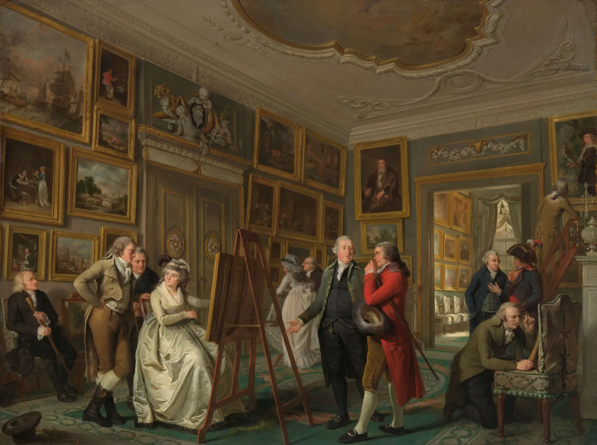
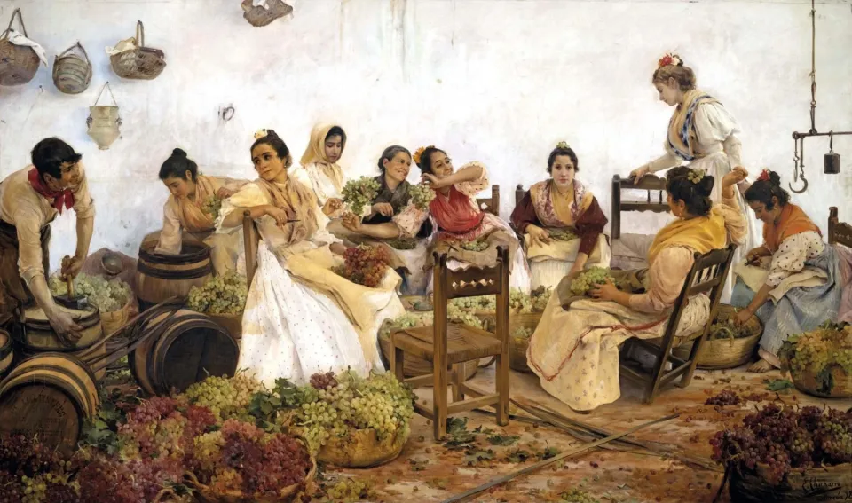
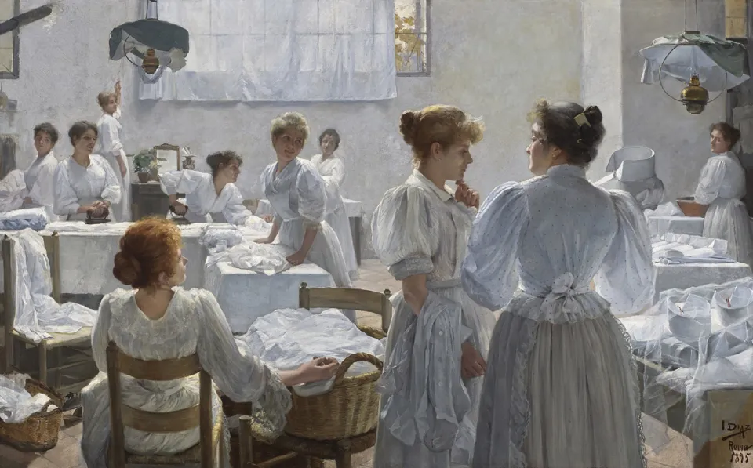
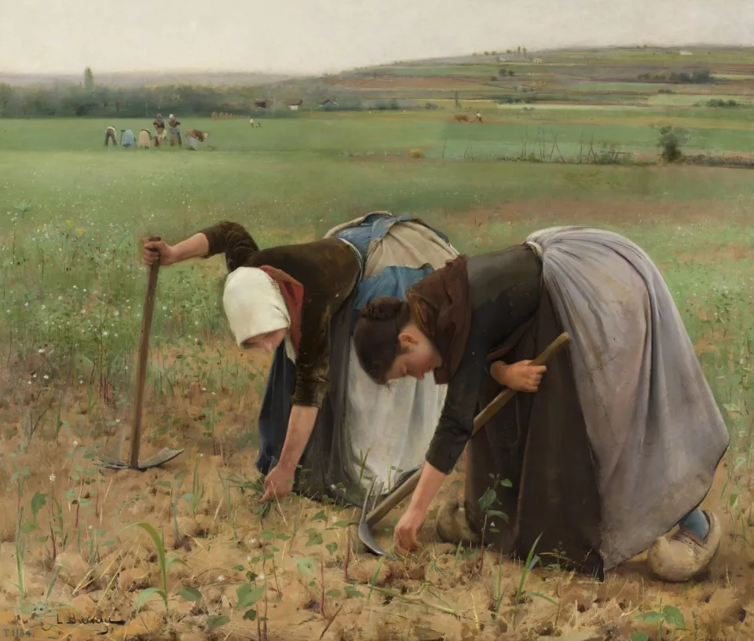
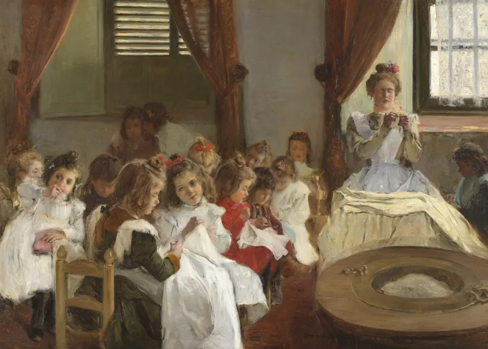

```{=html}
<figure class="welcome">
  
  <figcaption>Adriaan de Lelie, <em>The Art Gallery of Jan Gildemeester Jansz</em>, 1794–95. Oil on panel. Rijksmuseum, Amsterdam (SK-A-4100). Public domain.</figcaption>
</figure>

<section class="cover" aria-labelledby="cover-title">
  <h1 id="cover-title" class="cover-title">
    <span>Coding Provenance</span>
    <span>Workshop</span>
  </h1>
  <p class="cover-edition">Second Edition</p>
  <p class="cover-summary">This is the materials site for the second edition of the Coding Provenance Workshop: four days on computational provenance, meaning provenance research with statistics, network analysis, optical character recognition, large language models and natural language processing. Here you find the sessions, the readings and the materials for each step of the workflow.</p>
  <dl class="cover-meta">
    <div><dt>Dates</dt><dd><time datetime="2026-12-01">December 1</time>–<time datetime="2026-12-04">4, 2026</time></dd></div>
    <div><dt>Venue</dt><dd>Getty Research Institute, Los Angeles</dd></div>
    <div><dt>Partners</dt><dd>Provenance Lab, Leuphana University of Lüneburg, and the Getty Provenance Index</dd></div>
  </dl>
</section>

<section class="schedule" aria-labelledby="schedule">
  <h2 id="schedule">Schedule</h2>
  <div class="schedule-days">
    <section class="schedule-day" aria-labelledby="day-1">
      <h3 id="day-1"><span class="day-no">Day 1</span> Tuesday, <time datetime="2026-12-01">December 1</time></h3>
      <dl>
        <div><dt>09:00–10:00</dt><dd>Reception &amp; Coffee</dd></div>
        <div><dt>10:00–12:00</dt><dd>Welcome Session</dd></div>
        <div><dt>12:00–13:00</dt><dd>Lunch</dd></div>
        <div><dt>13:00–18:00</dt><dd>Workshop Part I – Knowledge Design</dd></div>
        <div><dt>18:30–20:00</dt><dd>Welcoming Snacks &amp; Drinks</dd></div>
      </dl>
    </section>
    <section class="schedule-day" aria-labelledby="day-2">
      <h3 id="day-2"><span class="day-no">Day 2</span> Wednesday, <time datetime="2026-12-02">December 2</time></h3>
      <dl>
        <div><dt>09:00–12:00</dt><dd>Workshop Part II &amp; III – Learning How to Code</dd></div>
        <div><dt>12:00–13:30</dt><dd>Lunch Break &amp; Knoedler Archives Session</dd></div>
        <div><dt>13:30–15:00</dt><dd>Workshop Part IV – Data Analysis</dd></div>
        <div><dt>16:00–19:30</dt><dd>Book Launch &amp; Reception at the Getty Villa</dd></div>
      </dl>
    </section>
    <section class="schedule-day" aria-labelledby="day-3">
      <h3 id="day-3"><span class="day-no">Day 3</span> Thursday, <time datetime="2026-12-03">December 3</time></h3>
      <dl>
        <div><dt>09:00–12:00</dt><dd>Workshop Part V – Network Analysis</dd></div>
        <div><dt>12:00–13:00</dt><dd>Lunch Break</dd></div>
        <div><dt>13:00–14:30</dt><dd>Presentation of Getty Digital</dd></div>
        <div><dt>15:00–18:00</dt><dd>Workshop Part VI – Information Visualization</dd></div>
        <div><dt>19:00</dt><dd>Pizza at the Getty Scholar Housing</dd></div>
      </dl>
    </section>
    <section class="schedule-day" aria-labelledby="day-4">
      <h3 id="day-4"><span class="day-no">Day 4</span> Friday, <time datetime="2026-12-04">December 4</time></h3>
      <dl>
        <div><dt>09:00–13:00</dt><dd>Work on Projects</dd></div>
        <div><dt>15:00</dt><dd>Group Presentations</dd></div>
        <div><dt>18:00</dt><dd>Dinner</dd></div>
      </dl>
    </section>
  </div>
</section>

<section class="ledger" aria-labelledby="materials">
  <h2 id="materials">Materials</h2>
  <table class="ledger-table">
    <thead>
      <tr><th scope="col" class="no">No.</th><th scope="col">Entry</th><th scope="col">Part</th></tr>
    </thead>
    <tbody>
      <tr>
        <td class="no">001</td>
        <td class="entry"><a href="structuring-data.html">Knowledge Design</a><span class="desc">Organizing provenance data into consistent structures.</span></td>
        <td class="part">Workflow, step 1 of 4</td>
      </tr>
      <tr>
        <td class="no">002</td>
        <td class="entry"><a href="preprocessing-data.html">Preprocessing Data</a><span class="desc">Python, from raw text to structured data, and cleaning, normalizing, harmonizing and reconciling data.</span></td>
        <td class="part">Workflow, step 2 of 4</td>
      </tr>
      <tr>
        <td class="no">003</td>
        <td class="entry"><a href="analysing-data.html">Analyzing Data</a><span class="desc">Basic statistics, data visualization and network analysis.</span></td>
        <td class="part">Workflow, step 3 of 4</td>
      </tr>
      <tr>
        <td class="no">004</td>
        <td class="entry"><a href="visualising-data.html">Visualizing Data</a><span class="desc">Charts, maps and networks.</span></td>
        <td class="part">Workflow, step 4 of 4</td>
      </tr>
      <tr>
        <td class="no">005</td>
        <td class="entry"><a href="resources.html">Bibliography &amp; Resources</a><span class="desc">Readings, tutorials, tools and datasets.</span></td>
        <td class="part">Reference</td>
      </tr>
    </tbody>
  </table>
</section>

<section class="plates" aria-labelledby="plates">
  <h2 id="plates">Plates</h2>
  <p class="plates-intro">Each workflow page carries one painting with its record and provenance.</p>
  <div class="plate-grid">
    <figure>
      <a href="structuring-data.html">
        
        <figcaption><span class="pl-no">No. 001</span><span><span class="pl-step">Knowledge Design</span>Eduardo Chicharro Agüera, <em>Las uveras</em>, 1898<span class="pl-rights">© Herederos de Eduardo Chicharro Agüera</span></span></figcaption>
      </a>
    </figure>
    <figure>
      <a href="preprocessing-data.html">
        
        <figcaption><span class="pl-no">No. 002</span><span><span class="pl-step">Preprocessing Data</span>Ignacio Díaz Olano, <em>Las planchadoras</em>, 1895</span></figcaption>
      </a>
    </figure>
    <figure>
      <a href="analysing-data.html">
        
        <figcaption><span class="pl-no">No. 003</span><span><span class="pl-step">Analyzing Data</span>Laureano Barrau Buñol, <em>Escardadoras</em>, 1891<span class="pl-rights">© rights holder to be confirmed</span></span></figcaption>
      </a>
    </figure>
    <figure>
      <a href="visualising-data.html">
        
        <figcaption><span class="pl-no">No. 004</span><span><span class="pl-step">Visualizing Data</span>Domingo Muñoz y Cuesta, <em>La amiga (En Córdoba)</em>, 1901</span></figcaption>
      </a>
    </figure>
  </div>
</section>
```
